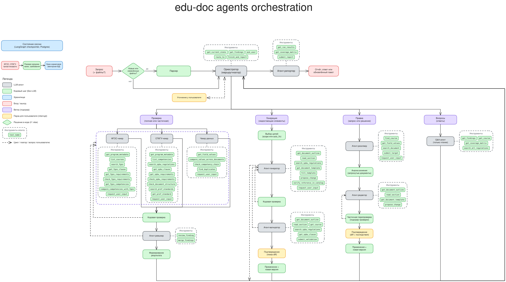

# ADR-0003: Оркестрация агентов на LangGraph и LangChain

- Статус: предложено
- Дата: 2026-10-24
- Участники: Карим М (автор)

## Общая схема

Обработку каждого запроса пользователя выполняет оркестратор. Он определяет, какой из четырёх
подграфов запускается: проверка, генерация, правка или ответы на вопросы. Каждый подграф
представляет собой заданную последовательность агентов и кодовых шагов. По завершении подграф
возвращает результат оркестратору, который запускает следующий подграф либо передаёт результаты
агенту-репортеру.

Взаимодействие с пользователем в ходе обработки запроса осуществляет только оркестратор.
Оркестрация реализована на LangGraph и LangChain.

## Обработка запроса пользователя

1. Пользователь направляет запрос, с файлами или без них.
2. При наличии новых или изменённых файлов парсер извлекает из них данные программы. В противном
   случае используются данные, сохранённые при обработке предыдущих запросов.
3. Оркестратор анализирует запрос и текущее состояние. Если запрос неясен или недостаточно данных,
   оркестратор запрашивает уточнение у пользователя.
4. Оркестратор запускает подграф и указывает объём работы: перечень проверок, документов,
   замечаний или целей.
5. Подграф выполняется и сохраняет результат.
6. Оркестратор анализирует результат. Если запрос требует запуска ещё одного подграфа (например,
   «проверить и исправить»), оркестратор запускает его. Если подграф сообщает о недостающих
   данных, оркестратор запрашивает их у пользователя и запускает подграф повторно.
7. По завершении обработки агент-репортер формирует ответ: протокол проверки, перечень изменений
   или ответ на вопрос.

Состояние сохраняется после каждого шага. Последующие запросы по тому же пакету документов
обрабатываются на основе сохранённого состояния. При сбое выполнение возобновляется с последнего
завершённого шага.

## Подграфы

### Проверка

1. Три чекера работают параллельно:
    - ФГОС-чекер проверяет соответствие программы ФГОС;
    - СПбГУ-чекер проверяет соответствие нормам СПбГУ и профстандартам;
    - чекер данных проверяет согласованность документов между собой.
2. Каждое замечание проходит кодовую проверку всего, что поддаётся объективной проверке.
   Замечание, не прошедшее её, возвращается составившему его чекеру с указанием причины. После
   двух неудачных попыток замечание отбрасывается.
3. Агент-ревьюер проверяет смысловую и субъективную часть замечания, например, подтверждает ли
   приведённое требование выявленное нарушение. По итогам замечание принимается, отклоняется,
   возвращается чекеру на доработку (не более двух раз) или передаётся на рассмотрение человеку.
   Агент-ревьюер также объединяет одинаковые замечания, выявленные разными чекерами.
4. Кодовый шаг формирует результат: перечень замечаний, матрицу покрытия компетенций и итоговый
   вердикт («нарушений нет», «есть нарушения» или «проверка неполная», если один из чекеров не
   завершил работу).

### Генерация

1. Кодовый шаг определяет перечень генерируемых элементов: по запросу пользователя или по
   замечаниям, допускающим автоматическое исправление.
2. Агент-генератор формирует содержимое. При отсутствии в документах необходимых данных генерация
   приостанавливается, и оркестратор запрашивает их у пользователя.
3. Кодовая проверка охватывает всё, что поддаётся объективной проверке: наличие обязательных
   разделов, соответствие чисел и кодов данным программы, корректность файла.
4. Агент-валидатор проверяет смысловую часть: согласованность содержимого с остальными
   документами и соответствие нормативным требованиям.
5. При непрохождении любой из проверок содержимое возвращается агенту-генератору (не более двух
   раз).
6. Изменение сохраняется как новая версия документа только после подтверждения пользователем.

### Правка

1. Агент-резолвер определяет, какой элемент требуется изменить. При неоднозначности оркестратор
   запрашивает уточнение у пользователя.
2. Кодовый шаг определяет всё, на что влияет изменение: то же значение в других документах,
   вычисляемые значения, итоговые показатели.
3. Агент-редактор подготавливает изменение.
4. Затронутые части проходят повторную проверку. Если изменение приводит к новым нарушениям, оно
   возвращается агенту-редактору (не более двух раз).
5. Пользователю предоставляется изменение с перечнем последствий. Изменение сохраняется как новая
   версия документа только после подтверждения.

### Вопросы

Q&A-агент отвечает на вопросы о программе, замечаниях и нормативных документах. Данные программы
и замечания он получает через свои инструменты, поиск по нормативным документам выполняет через
RAG-компонент.

## Обращения к пользователю

- **Запрос неясен или отсутствует необходимый документ:** уточнение запрашивает оркестратор до
  запуска подграфа.
- **Подграф сообщил о недостающих данных или неоднозначной цели:** уточнение запрашивает
  оркестратор после возврата результата подграфом.
- **Перед сохранением любого изменения:** подтверждение в подграфах генерации и правки.

## Инструменты

### Оркестратор

| Инструмент | Назначение |
| --- | --- |
| `get_current_state` | Текущее состояние сессии: последние результаты подграфов, открытые вопросы |
| `get_findings` | Замечания с фильтрацией по статусу, критичности, возможности исправления, чекеру, документу |
| `ask_user` | Вопрос пользователю с ожиданием ответа |
| `route_to` | Запуск подграфа с указанием объёма работы: чекеры, документы, цели, ID замечаний |
| `finish_and_report` | Завершение обработки и передача результатов агенту-репортеру |

### Общие инструменты чекеров

| Инструмент | Назначение |
| --- | --- |
| `get_course` | Данные дисциплины с указанием источника каждого значения |
| `report_finding` | Передача замечания с проверкой заполненности полей |
| `revise_finding` | Исправление замечания, возвращённого на доработку |
| `withdraw_finding` | Отзыв замечания |

### ФГОС-чекер

| Инструмент | Назначение |
| --- | --- |
| `get_program_metadata` | Код направления, уровень, форма обучения, год, профиль |
| `list_courses` | Перечень дисциплин с трудоёмкостью и семестрами |
| `search_fgos` | Поиск по ФГОС; возвращает пункты со ссылками для цитирования |
| `get_fgos_clause` | Полный текст пункта по ссылке |
| `get_fgos_requirements` | Числовые требования ФГОС |
| `check_fgos_requirements` | Сверка данных программы с числовыми требованиями; возвращает нарушения |
| `get_fgos_competencies` | Перечень УК и ОПК |
| `compare_competencies_with_fgos` | Сравнение УК/ОПК программы с ФГОС: отсутствующие, лишние, изменённые формулировки |

### СПбГУ-чекер

| Инструмент | Назначение |
| --- | --- |
| `get_program_metadata` | Код направления, уровень, форма обучения, год, профиль |
| `list_competencies` | Перечень компетенций с индикаторами |
| `search_spbu_regulations` | Поиск по нормам СПбГУ; возвращает пункты со ссылками для цитирования |
| `get_spbu_clause` | Полный текст пункта по ссылке |
| `get_spbu_requirements` | Числовые требования СПбГУ |
| `check_spbu_requirements` | Сверка данных программы с числовыми требованиями; возвращает нарушения |
| `check_document_structure` | Обязательные разделы: отсутствующие, лишние, нарушенный порядок |
| `search_prof_standards` | Поиск по профстандартам |
| `get_prof_standard` | Сведения о профстандарте: статус, трудовые функции |

### Чекер данных

| Инструмент | Назначение |
| --- | --- |
| `get_field_values` | Значения поля во всех документах с указанием источников |
| `compare_values_across_documents` | Расхождения значений, неверные итоги, отсутствующие значения |
| `check_competency_chain` | Разрывы в цепочке компетенция → индикатор → дисциплина → оценочное средство; построение матрицы покрытия |
| `find_duplicates` | Дублирующиеся компетенции, дисциплины, содержание |

### Агент-ревьюер

| Инструмент | Назначение |
| --- | --- |
| `review_finding` | Решение по замечанию: принять, отклонить, вернуть на доработку или передать человеку, с обоснованием |
| `merge_findings` | Объединение дублирующихся замечаний |

### Агент-генератор

| Инструмент | Назначение |
| --- | --- |
| `get_document_outline` | Перечень разделов документа с их ID |
| `read_section` | Текст и таблицы раздела |
| `search_spbu_regulations` | Требования к генерируемому элементу |
| `get_document_template` | Шаблон документа |
| `fill_template` | Заполнение шаблона данными программы; возвращает черновик и незаполненные поля |
| `propose_change` | Подготовка изменения к подтверждению |
| `verify_reference_in_catalog` | Проверка источника литературы по библиотечному каталогу |
| `request_user_input` | Передача оркестратору перечня недостающих данных |

### Агент-валидатор

| Инструмент | Назначение |
| --- | --- |
| `get_document_outline` | Перечень разделов документа с их ID |
| `read_section` | Текст смежных разделов |
| `get_course` | Данные дисциплины |
| `search_spbu_regulations` | Требования к разделу |
| `get_spbu_clause` | Полный текст пункта |
| `submit_validation` | Результат проверки (пройдена / не пройдена) с перечнем проблем |

### Агент-резолвер

| Инструмент | Назначение |
| --- | --- |
| `find_course` | Поиск дисциплины по неточному названию; возвращает наиболее подходящие варианты |
| `get_field_values` | Места, где встречается изменяемое значение |
| `search_document` | Поиск фрагмента текста |
| `submit_target` | Определённая цель изменения: что и где изменить |
| `request_user_input` | Передача оркестратору возможных вариантов цели |

### Агент-редактор

| Инструмент | Назначение |
| --- | --- |
| `get_document_outline` | Перечень разделов документа с их ID |
| `read_section` | Текст изменяемого раздела |
| `get_document_template` | Шаблон документа для сохранения структуры |
| `propose_change` | Подготовка изменения к подтверждению |

### Q&A-агент

| Инструмент | Назначение |
| --- | --- |
| `get_findings` | Замечания с полной информацией |
| `get_course` | Данные дисциплины |
| `get_coverage_matrix` | Пробелы в покрытии компетенций или связи отдельной компетенции либо дисциплины |
| `search_all_regulations` | Поиск по ФГОС, нормам СПбГУ и профстандартам через RAG-компонент с указанием источника каждого результата |

### Агент-репортер

| Инструмент | Назначение |
| --- | --- |
| `get_run_results` | Результаты всех подграфов, запущенных при обработке запроса |
| `get_coverage_matrix` | Сводка по покрытию компетенций и пробелы; полная таблица формируется кодом |
| `submit_report` | Проверка полноты отчёта и его формирование |
