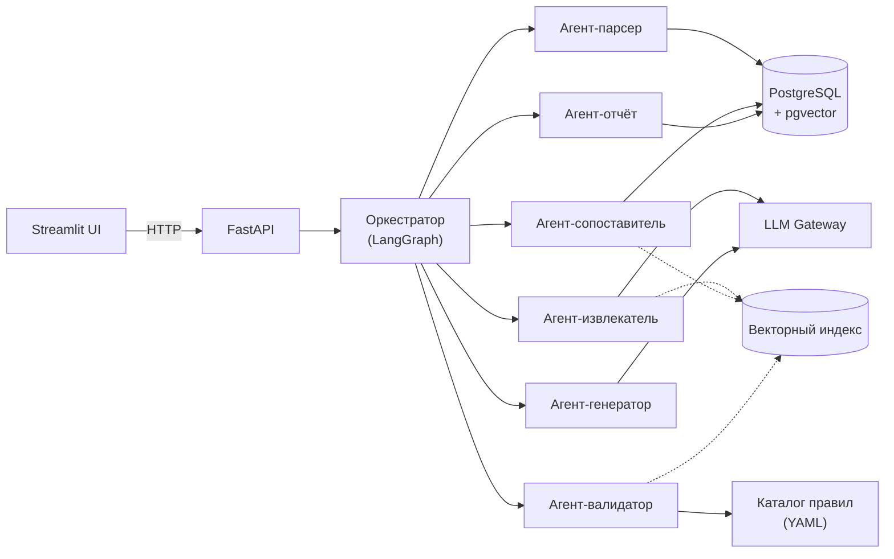

# Архитектура

## Общая схема

## Модули

| Модуль | Ответственность | Статус |
|---|---|---|
| `parsing/` | Загрузка и парсинг PDF, DOCX, XLSX, OCR. Сохранение структуры разделов, таблиц и приложений. | M2 |
| `extraction/` | Извлечение сущностей: компетенции, индикаторы, дисциплины, семестры, трудоёмкость, формы контроля, оценочные средства. | M2 |
| `retrieval/` | RAG-подсистема: векторный индекс, поиск по нормативным документам, шаблонам и методическим рекомендациям. | M2 |
| `validation/` | Rule engine и LLM-проверки: полнота, непротиворечивость, покрытие, соответствие ФГОС ВО и профстандартам. | M3 |
| `generation/` | Генерация недостающих разделов, титульных листов, пояснительных записок, сводных таблиц. | M3 |
| `reporting/` | Протоколы проверки, карты связей, перечень ошибок и рекомендаций. | M3 |
| `orchestration/` | Граф LangGraph, общее состояние, маршрутизация задач, обработка исключений. | M2 |
| `api/` | HTTP-слой: роутеры, схемы запросов и ответов. | M2 |
| `llm/` | Единый шлюз к LLM: клиент, кэш, ретраи, подмена в тестах. | M2 |
| `db/` | Модели SQLAlchemy, миграции Alembic, сессии. | M2 |

## Стек

- **Язык:** Python 3.12.
- **API:** FastAPI + Uvicorn.
- **UI:** Streamlit.
- **Оркестрация агентов:** LangGraph (плюс LangChain для интеграций).
- **LLM:** внешний провайдер (уточняется) + возможность запускать
  локальную модель через Ollama (профиль `local-llm` в `compose.yaml`).
- **RAG:** pgvector внутри PostgreSQL; на ранних этапах — FAISS локально.
- **БД:** PostgreSQL 17 с расширением pgvector.
- **Парсинг:** python-docx, openpyxl, pdfplumber, Tesseract/OCR.
- **Инфраструктура:** Docker Compose, GitHub Actions, GitHub Container Registry.

## Данные

Реальные документы ОП **вне репозитория**:

- в облачном хранилище команды;
- локально у разработчика — путь в `DATA_DIR`.

В `tests/fixtures/` — только синтетические документы, см.
[CONTRIBUTING.md](https://github.com/Apophis142/edu-doc-agent/blob/main/CONTRIBUTING.md).

## Конфигурация

Все настройки — через `.env`, читаются в `src/edu_doc_agent/config.py`
(`pydantic-settings`). Шаблон — `.env.example`. Файл `.env` в git не попадает.

## Открытые вопросы

- Какой LLM-провайдер используем по умолчанию (внешний API или локальная
  модель)? — ADR появится в M1.
- Векторное хранилище: pgvector vs Qdrant vs Chroma. — ADR в M2.
- Формат каталога правил (`rules/*.yaml`): один файл на правило или один
  файл на группу? — ADR в M1.
