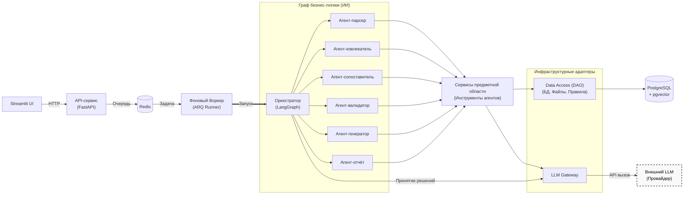

# Архитектура

Этот документ описывает общую функциональную архитектуру системы.
> **Детальная документация по подсистемам:**
> - Инфраструктура, масштабирование, работа с Redis и ARQ описаны в [Архитектуре бекенда](backend-architecture.md).
> - Внутреннее устройство графа и ИИ-агентов зафиксировано в [ADR-0003](adr/0003-agent-orchestration.md).

## Общая логическая схема

## Модули

В кодовой базе используется плоская физическая структура каталогов, однако архитектурно модули разделены на три логических слоя:

| Модуль | Ответственность | Статус |
|---|---|---|
| **Слой 1: Инфраструктура и Транспорт** | *(Ввод-вывод, очереди, адаптеры к БД и внешним API)* | |
| `api/` | HTTP-слой: роутеры, схемы запросов и ответов, постановка задач в очередь. | M2 |
| `worker/` | Runner на ARQ: запуск графа, управление паузами, таймаутами, повторами и идемпотентностью. | M2 |
| `llm/` | LLM Gateway: единый шлюз к провайдерам (клиент, кэш, ретраи, лимиты). | M2 |
| `dao/` | Data Access: модели SQLAlchemy, миграции Alembic, сессии; файловое хранилище (`/storage`); чтение каталога правил (YAML). | M2 |
| **Слой 2: Оркестрация** | *(Координация процессов и принятие решений)* | |
| `orchestration/` | Граф LangGraph, общее состояние, маршрутизация задач агентами, обработка исключений. | M2 |
| **Слой 3: Предметные службы (Domain Services)** | *(Инструменты бизнес-логики для графа)* | |
| `parsing/` | Загрузка и парсинг PDF, DOCX, XLSX, OCR. Сохранение структуры разделов, таблиц и приложений. | M2 |
| `extraction/` | Извлечение сущностей: компетенции, индикаторы, дисциплины, семестры, трудоёмкость, формы контроля. | M2 |
| `retrieval/` | RAG-подсистема: векторный индекс, поиск по нормативным документам, шаблонам и методическим рекомендациям. | M2 |
| `validation/` | Rule engine и математические проверки: полнота, непротиворечивость, покрытие, соответствие ФГОС ВО. | M3 |
| `generation/` | Генерация недостающих разделов, матриц покрытия, пояснительных записок, финальная сборка файлов. | M3 |
| `reporting/` | Протоколы проверки, карты связей, формирование структур данных для вывода ошибок и рекомендаций. | M3 |

## Стек

- **Язык:** Python 3.12.
- **UI:** Streamlit.
- **API и Валидация:** FastAPI + Uvicorn, Pydantic 2.x.
- **Очередь задач:** Redis + ARQ (для асинхронного фонового воркера).
- **Оркестрация агентов:** LangGraph + LangChain (Checkpointer использует PostgreSQL для сохранения состояния графа).
- **LLM:** внешний провайдер (через единый Gateway) + возможность локального запуска через Ollama.
- **БД и RAG:** PostgreSQL 17 с расширением `pgvector` (единое хранилище для диалогов, модели ОП и векторного поиска). ORM: SQLAlchemy + Alembic.
- **Парсинг документов:** python-docx, openpyxl, pdfplumber, Tesseract/OCR.
- **Хранение данных:** локальный Docker Volume (`/storage`) для файлов документов и YAML для каталога правил.
- **Инфраструктура:** Docker Compose, GitHub Actions, GitHub Container Registry.

## Данные

Реальные документы ОП **вне репозитория**:

- в облачном хранилище команды;
- локально у разработчика — путь в `DATA_DIR`.

В `tests/fixtures/` — только синтетические документы, см.
[CONTRIBUTING.md](https://github.com/Apophis142/edu-doc-agent/blob/main/CONTRIBUTING.md).

## Конфигурация

Все настройки — через `.env`, читаются в `src/edu_doc_agent/config.py`
(`pydantic-settings`). Шаблон — `.env.example`. Файл `.env` в git не попадает.

## Открытые вопросы

- Какой LLM-провайдер используем по умолчанию (внешний API или локальная
  модель)? — ADR появится в M1.
- Формат каталога правил (`rules/*.yaml`): один файл на правило или один
  файл на группу? — ADR в M1.
