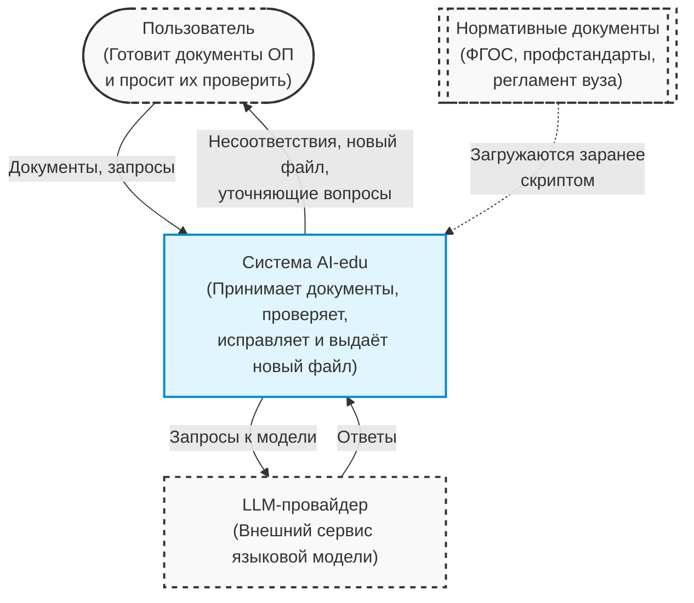
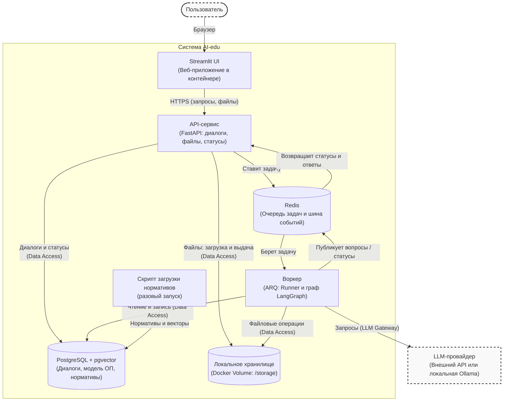
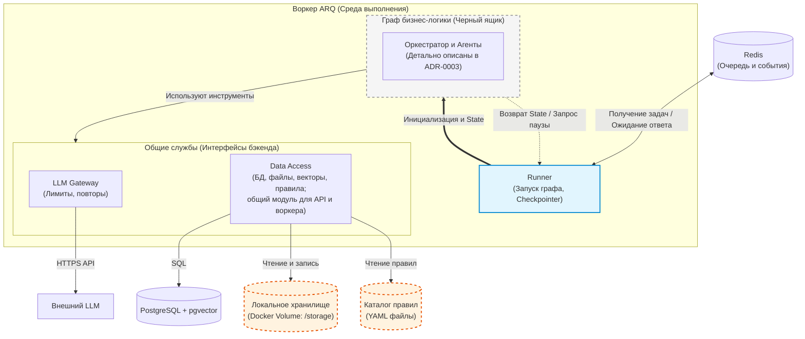

# Архитектура бекенда системы AI-edu

## Архитектурное решение

Бекенд — модульный монолит: один API-сервис и один фоновый воркер на общей кодовой базе. Вместе они превращают диалог с пользователем в процесс «разобрать документы → проверить → исправить → собрать новый документ».

- **Чат как единственный вход:** Пользователь загружает документы, просит проверить их, затем просит исправить конкретное несоответствие.
- **Тонкий API, тяжёлый воркер:** Связка «FastAPI → Redis → Worker». API принимает сообщения и файлы, ставит задачу в очередь Redis, передаёт статус потоком и отдаёт файлы. Парсинг, вызовы LLM и сборка документа идут в воркере, поэтому долгие задачи не блокируют API.
- **Граф бизнес-логики как чёрный ящик:** Логика воркера построена на LangGraph и представляет собой конечный автомат, а не жёсткий конвейер. Граф разрабатывает ИИ-команда: он сам определяет намерение, направляет задачу в один из подграфов («Проверка», «Генерация», «Правка», «Вопросы») и управляет общим состоянием (State). Бекенд отвечает за среду выполнения: запуск графа, сохранение State, паузы и общие службы.
- **Human-in-the-loop:** Если графу не хватает данных или возникает неоднозначность, его выполнение приостанавливается. Воркер отправляет через API вопрос пользователю в чат и ждёт ответа в виде события. Когда ответ приходит, граф возобновляется с сохранённого состояния.
- **Код считает, LLM читает:** Числа и совпадения проверяет код. LLM нужен, чтобы понять свободный текст документа и написать недостающий фрагмент.
- **Модель ОП вместо файла:** Из загруженных файлов извлекается структурированная модель (дисциплины, компетенции, индикаторы, разделы РПД и связи между ними). Проверки и исправления работают с моделью.
- **Исходный файл не меняется:** Исправление вносится в модель, а из неё и шаблона собирается новый DOCX или PDF.
- **Файловое хранилище:** Загруженные оригиналы и сформированные документы лежат в Docker Volume (`/storage`), общем для API и воркера.
- **Управление состоянием (State):** Мы не храним историю правок файла документа (как в Google Docs), но Checkpointer LangGraph сохраняет состояние графа в PostgreSQL при каждом переходе между узлами. Это позволяет возобновлять работу после пауз и поддерживать длительные сессии.
- **Единое хранилище данных:** Диалоги, модель ОП, найденные несоответствия, состояние графа и векторы нормативов лежат в PostgreSQL с расширением `pgvector`. Отдельной векторной базы нет.
- **Нормативы через RAG:** ФГОС, профстандарты и регламент вуза хранятся в PostgreSQL в виде векторных представлений и индексируются для гибридного (векторного и полнотекстового) поиска.
- **Общие службы:** Ни граф бизнес-логики, ни API не обращаются напрямую к базам и файлам, а граф не обращается напрямую к LLM. Data Access — общий модуль монолита: им пользуются и API, и воркер. Все вызовы идут через `LLM Gateway`, а обращения к данным — через `Data Access`.

## С4, уровень 1: Контекст системы

Пользователь готовит документы ОП и просит их проверить. Он передаёт в систему AI-edu документы и запросы, а получает несоответствия и новый документ. Если системе не хватает данных, она сама задаёт пользователю уточняющий вопрос в чате и продолжает работу после ответа.

Из внешних сервисов системе нужен только LLM-провайдер: она отправляет ему запросы к модели и получает ответы. Нормативные документы загружаются в PostgreSQL заранее скриптом и в рабочем режиме внешней интеграцией не являются.

## С4, уровень 2: Контейнеры

Веб-интерфейс, один API, один воркер, Redis и два хранилища; вовне только LLM.

- **Streamlit UI** — чат-интерфейс в браузере. Общается только с API.
- **API-сервис (FastAPI + Uvicorn)** отвечает за диалоги, файлы, статусы и постановку задач. Через общий модуль Data Access он пишет диалоги в PostgreSQL, сохраняет загруженные файлы в `/storage` и отдаёт готовые, доставляет в чат вопросы воркера к пользователю и принимает ответы.
- **Redis** служит очередью задач и шиной событий. Через него идут задачи, статусы, вопросы пользователю и ответы на них.
- **Воркер (ARQ)** запускает граф бизнес-логики на LangGraph в среде выполнения Runner. Он читает и пишет данные в PostgreSQL и `/storage`, читает каталог правил (YAML) и обращается к LLM-провайдеру.
- **PostgreSQL с pgvector** хранит диалоги, модель ОП, несоответствия, состояние графа и векторы нормативов.
- **Локальное хранилище (Docker Volume `/storage`)** хранит загруженные оригиналы и сформированные документы. Том общий для API и воркера.
- **Скрипт загрузки нормативов** запускается вручную один раз и пишет нормативы и их векторы в PostgreSQL.

*Технологии: Python 3.12, FastAPI, Pydantic 2, Streamlit, Redis + ARQ, LangGraph, PostgreSQL 17 + pgvector, Docker Compose.*

## С4, уровень 3: Компоненты воркера

Воркер предоставляет среду выполнения (инфраструктуру и общие службы) для графа бизнес-логики, который разрабатывает ИИ-команда. Для бекенда граф — чёрный ящик: устройство оркестратора, подграфов и агентов описано в ADR-0003 и здесь не дублируется.

**Runner** запускает задачу ARQ, инициализирует State и передаёт его в граф. Он создаёт Checkpointer LangGraph на пуле соединений Data Access и передаёт его в граф. Сам граф сохраняет State в PostgreSQL при каждом переходе между узлами. Когда граф запрашивает паузу, Runner публикует вопрос в Redis, ждёт ответа и возобновляет граф с сохранённого состояния.

**Граф бизнес-логики** получает State и общие службы, выполняет сценарии «Проверка», «Генерация», «Правка» и «Вопросы» и возвращает обновлённый State либо запрос паузы. Его внутреннее устройство бекенд не определяет.

**Общие службы (интерфейсы бекенда):**

- **LLM Gateway:** Контроль лимитов, повторов, учёт токенов; единственная точка выхода к LLM-провайдеру.
- **Data Access:** Общая служба монолита: ею пользуются и API, и воркер. Чтение и запись в PostgreSQL (модель ОП, состояние графа, гибридный поиск по нормативам), в файловое хранилище (Docker Volume `/storage`) и чтение каталога правил (только чтение).

Граф не ходит напрямую ни в базы, ни в файлы, ни в LLM, исключений нет.

**Каталог правил** — YAML-файлы с правилами проверки (`rules/*.yaml`). Граф читает их через Data Access. Формат каталога — в открытых вопросах.

## Модули

| Модуль | Ответственность | Статус |
| --- | --- | --- |
| `api/` | HTTP-слой: роутеры, схемы запросов и ответов, постановка задач в очередь. | M2 |
| `llm/` | LLM Gateway: клиент, кэш, ретраи, лимиты, подмена в тестах. | M2 |
| `dao/` | Data Access: модели SQLAlchemy, миграции Alembic, сессии; файловое хранилище (`/storage`); чтение каталога правил (YAML). Общий модуль для `api/` и `worker/`. | M2 |
| `worker/` | Runner на ARQ: запуск графа, инициализация Checkpointer (State в PostgreSQL), пауза и возобновление через Redis. | M2 |

## Стек

- **Язык:** Python 3.12.
- **API:** FastAPI + Uvicorn.
- **Валидация и схемы:** Pydantic 2.x (плюс `pydantic-settings` для конфигурации).
- **Очередь и события:** Redis + ARQ (для фонового Воркера).
- **UI:** Streamlit.
- **Оркестрация агентов:** LangGraph (State сохраняет Checkpointer на PostgreSQL, AsyncPostgresSaver; плюс LangChain для интеграций).
- **LLM:** внешний провайдер (через LLM Gateway) + возможность запускать локальную модель через Ollama (профиль `local-llm` в `compose.yaml`).
- **БД и RAG:** PostgreSQL 17 с расширением pgvector (единое хранилище для реляционных данных и векторов).
- **ORM и миграции:** SQLAlchemy + Alembic.
- **Файловое хранилище:** Docker Volume (`/storage`).
- **Каталог правил:** YAML-файлы (`rules/*.yaml`).
- **Парсинг (внутри графа, выбор ИИ-команды):** python-docx, openpyxl, pdfplumber, Tesseract/OCR.
- **Инфраструктура:** Docker Compose, GitHub Actions, GitHub Container Registry.

## Данные

Реальные документы ОП **вне репозитория**:

- в облачном хранилище команды;
- локально у разработчика — путь в `DATA_DIR`.

В `tests/fixtures/` — только синтетические документы, см. [CONTRIBUTING.md](https://github.com/Apophis142/edu-doc-agent/blob/main/CONTRIBUTING.md).

## Конфигурация

Все настройки — через `.env`, читаются в `src/edu_doc_agent/config.py` (`pydantic-settings`). Шаблон — `.env.example`. Файл `.env` в git не попадает.

## Открытые вопросы

- Какой LLM-провайдер используем по умолчанию (внешний API или локальная модель)? — ADR появится в M1.
- Формат каталога правил (`rules/*.yaml`): один файл на правило или один файл на группу? — ADR в M1.
