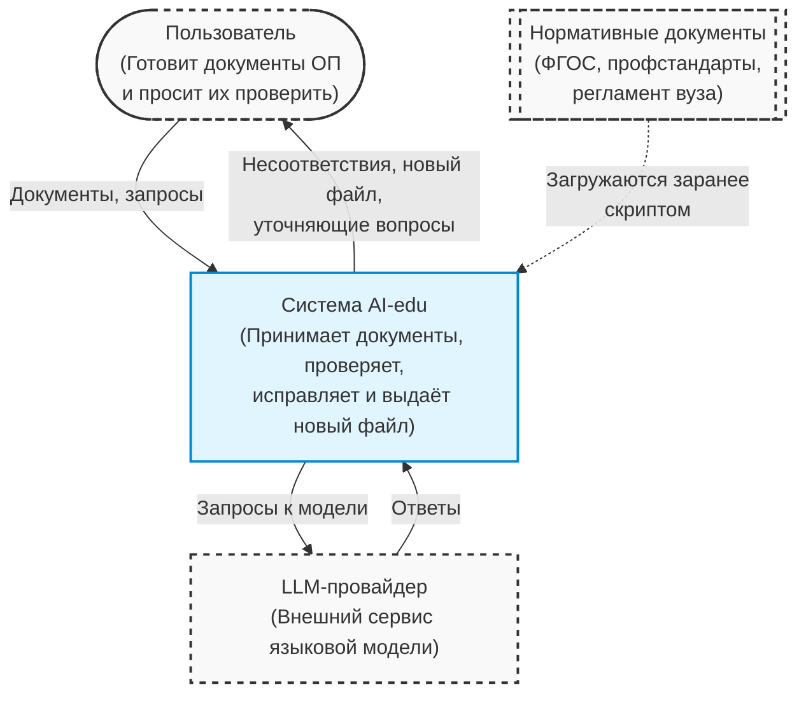
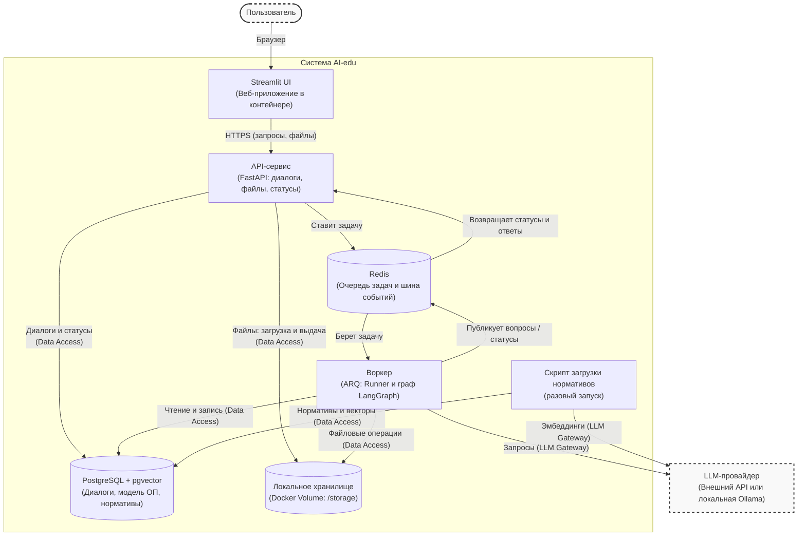
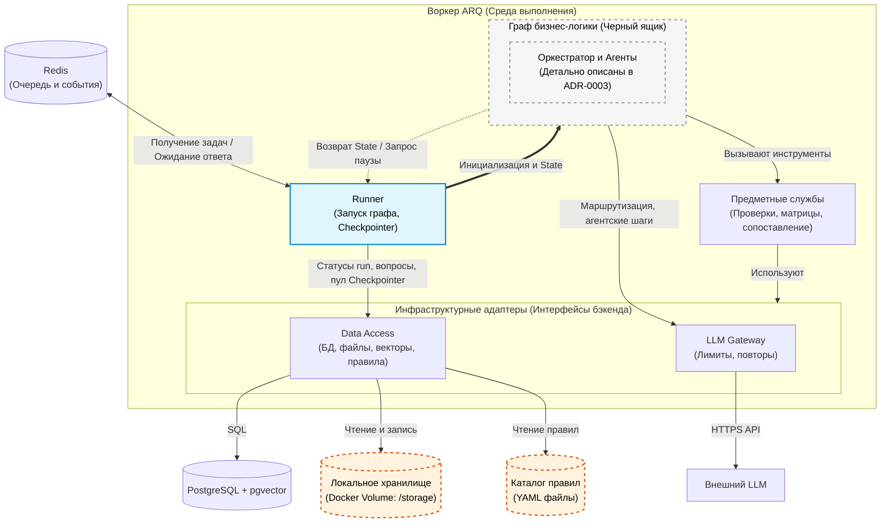

# Архитектура бекенда системы edu-doc-agent

## Архитектурное решение

Бекенд — модульный монолит: один API-сервис и один фоновый воркер на общей кодовой базе. Вместе они превращают диалог с пользователем в процесс «разобрать документы → проверить → исправить → собрать новый документ».

- **Чат как единственный вход:** Пользователь загружает документы, просит проверить их, затем просит исправить конкретное несоответствие.
- **Тонкий API, тяжёлый воркер:** Связка «FastAPI → Redis → Worker». API принимает сообщения и файлы, ставит задачу в очередь Redis, передаёт статус потоком и отдаёт файлы. Парсинг, вызовы LLM и сборка документа идут в воркере, поэтому долгие задачи не блокируют API.
- **Идемпотентность и повторы (Retries & Timeouts):** При сбое или таймауте задача ARQ может выполниться повторно. Архитектурное требование к системе — строгая идемпотентность шагов. Опираясь на стабильный `run_id`, повторный запуск графа не должен приводить к дублированию найденных ошибок (findings), созданию лишних версий документов или избыточным вызовам LLM.
- **Граф бизнес-логики как чёрный ящик:** Логика воркера построена на LangGraph и представляет собой конечный автомат, а не жёсткий конвейер. Граф разрабатывает ИИ-команда: он сам определяет намерение, направляет задачу в один из подграфов («Проверка», «Генерация», «Правка», «Вопросы») и управляет общим состоянием (State). Бекенд отвечает за среду выполнения: запуск графа, сохранение State, паузы и общие службы.
- **Human-in-the-loop:** Если графу не хватает данных или возникает неоднозначность, его выполнение приостанавливается. Воркер отправляет через API вопрос пользователю в чат и ждёт ответа в виде события. Когда ответ приходит, граф возобновляется с сохранённого состояния.
- **Код считает, LLM читает:** Числа и совпадения проверяет код. LLM нужен, чтобы понять свободный текст документа и написать недостающий фрагмент.
- **Модель ОП вместо файла:** Из загруженных файлов извлекается структурированная модель (дисциплины, компетенции, индикаторы, разделы РПД и связи между ними). Проверки и исправления работают с моделью.
- **Исходный файл не меняется:** Исправление вносится в модель, а из неё и шаблона собирается новый DOCX или PDF.
- **Файловое хранилище:** Загруженные оригиналы и сформированные документы лежат в Docker Volume (`/storage`), общем для API и воркера.
- **Происхождение документов:** Происхождение сформированного документа восстанавливается. Хранятся исходная версия документа, неподтверждённый ChangeProposal (предложенное исправление), подтверждение пользователя, результирующая версия и связь derived_from между версиями. Новая версия создаётся только после подтверждения.
- **Управление состоянием (State):** Checkpointer LangGraph сохраняет состояние графа в PostgreSQL при каждом переходе между узлами. Это позволяет возобновлять работу после пауз и поддерживать длительные сессии.
- **Разделение состояния и транспорта:** PostgreSQL выступает единственным источником истины (Source of Truth). Канонический статус выполнения (`queued`, `running`, `waiting_for_input`, `completed`), тексты уточняющих вопросов графа и ответы пользователя сохраняются в реляционных таблицах БД. Redis используется исключительно как эфемерный транспортный слой (очередь задач ARQ) и брокер доставки (Pub/Sub). При внезапном рестарте Redis данные не теряются, а зависшие задачи восстанавливаются по каноническим статусам из базы.
- **Единое хранилище данных:** Диалоги, модель ОП, найденные несоответствия, состояние графа и векторы нормативов лежат в PostgreSQL с расширением `pgvector`. Отдельной векторной базы нет.
- **Нормативы через RAG:** ФГОС, профстандарты и регламент вуза хранятся в PostgreSQL в виде векторных представлений и индексируются для гибридного (векторного и полнотекстового) поиска.
- **Общие службы:** Ни граф бизнес-логики, ни API не обращаются напрямую к базам и файлам, а граф не обращается напрямую к LLM. Data Access — общий модуль монолита: им пользуются и API, и воркер. Все вызовы идут через `LLM Gateway`, а обращения к данным — через `Data Access`.

## С4, уровень 1: Контекст системы

Пользователь готовит документы ОП и просит их проверить. Он передаёт в систему AI-edu документы и запросы, а получает несоответствия и новый документ. Если системе не хватает данных, она сама задаёт пользователю уточняющий вопрос в чате и продолжает работу после ответа.

Из внешних сервисов системе нужен только LLM-провайдер: она отправляет ему запросы к модели и получает ответы. Нормативные документы загружаются в PostgreSQL заранее скриптом и в рабочем режиме внешней интеграцией не являются.

## С4, уровень 2: Контейнеры

Веб-интерфейс, один API, один воркер, Redis и два хранилища; вовне только LLM.

- **Streamlit UI** — чат-интерфейс в браузере. Общается только с API.
- **API-сервис (FastAPI + Uvicorn)** отвечает за диалоги, файлы, статусы и постановку задач. Через общий модуль Data Access он пишет диалоги в PostgreSQL, сохраняет загруженные файлы в `/storage` и отдаёт готовые, доставляет в чат вопросы воркера к пользователю и принимает ответы.
- **Redis** служит исключительно транспортным слоем (очередь задач ARQ и доставка событий). Он не является источником истины: при его рестарте система восстанавливает каноническое состояние из PostgreSQL.
- **Воркер (ARQ)** запускает граф бизнес-логики на LangGraph в среде выполнения Runner. Он читает и пишет данные в PostgreSQL и `/storage`, читает каталог правил (YAML) и обращается к LLM-провайдеру.
- **PostgreSQL с pgvector** — хранит диалоги, канонические статусы задач, модель ОП, несоответствия, состояние графа и векторы нормативов.
- **Локальное хранилище (Docker Volume `/storage`)** хранит загруженные оригиналы и сформированные документы. Том общий для API и воркера (это ограничение single-node MVP). Чтобы в будущем систему можно было разнести на разные узлы, хранилище скрыто за интерфейсом (Data Access). Это позволит прозрачно заменить локальный том на S3-совместимое хранилище (например, MinIO) без изменений в коде графа.
- **Скрипт загрузки нормативов** запускается вручную один раз. Использует предметные службы (services/) для парсинга текстов и получения векторов, которые, в свою очередь, работают строго через инфраструктурные адаптеры (DAO и LLM Gateway).

*Технологии: Python 3.12, FastAPI, Pydantic 2, Streamlit, Redis + ARQ, LangGraph, PostgreSQL 17 + pgvector, Docker Compose.*

## С4, уровень 3: Компоненты воркера

Воркер предоставляет среду выполнения (инфраструктуру и общие службы) для графа бизнес-логики, который разрабатывает ИИ-команда. Для бекенда граф — чёрный ящик: устройство оркестратора, подграфов и агентов описано в ADR-0003 и здесь не дублируется.

**Runner** — инфраструктурная обёртка для запуска графа. Он берёт задачу из ARQ, инициализирует Checkpointer (на пуле Data Access) и вызывает граф.
Если граф запрашивает данные у пользователя (Human-in-the-loop), Checkpointer автоматически сохраняет State в PostgreSQL. После этого Runner не ждёт ответа, а полностью завершает текущую задачу в ARQ со статусом `waiting_for_input`, освобождая процесс воркера для других документов.
Когда ответ пользователя поступает в API, API ставит в Redis новую задачу на возобновление. Runner получает её, загружает сохранённый State и продолжает выполнение графа.

**Граф бизнес-логики** получает State и общие службы, выполняет сценарии «Проверка», «Генерация», «Правка» и «Вопросы» и возвращает обновлённый State либо запрос паузы. Его внутреннее устройство бекенд не определяет.

**Предметные службы и инфраструктура:**

Для изоляции бизнес-логики от работы с базами данных введён промежуточный слой:

- **Предметные службы (Domain Services):** Реализуют инструменты графа из ADR-0003 (проверки, сопоставление, построение матрицы покрытия, генерация). Службы выполняют всю математику и бизнес-логику, оркестрируя данные, но сами не работают с БД напрямую.
- **Инфраструктурные адаптеры:**
  - **LLM Gateway:** Контроль лимитов, повторов, учёт токенов; единственная точка выхода к LLM-провайдеру.
  - **Data Access (DAO):** Общая служба монолита для API, воркера и предметных служб. Выполняет исключительно I/O операции: чтение и запись в PostgreSQL (модель ОП, состояние графа), гибридный поиск, работу с Docker Volume (`/storage`) и парсинг YAML-правил. Любая бизнес-логика в DAO строго запрещена.

Граф не ходит напрямую ни в базы, ни в файлы, ни в LLM: он вызывает предметные службы, а те работают через инфраструктурные адаптеры (DAO и LLM Gateway). Исключение: для определения намерений и маршрутизации граф обращается к LLM Gateway напрямую.

**Каталог правил** — YAML-файлы с правилами проверки (`rules/*.yaml`). Предметные службы читают их через Data Access и используют при проверке. Формат каталога — в открытых вопросах.

### Жизненный цикл задачи и идентификаторы

Для корректного возобновления графа после пауз и исключения коллизий, бекенд опирается на строгую связку идентификаторов:
- **`session_id` (API)** = **`thread_id` (LangGraph)**: Сквозной идентификатор диалога пользователя с конкретной моделью ОП. Именно по нему Checkpointer находит нужный State в PostgreSQL при возобновлении после паузы.
- **`run_id`**: Стабильный идентификатор одного логического выполнения (например, одной проверки документа). Генерируется на стороне API в момент приема запроса. В отличие от эфемерного `job_id` (который меняется при каждом retry в ARQ), `run_id` остается неизменным. Именно на него опирается идемпотентность записи результатов в БД.
- **`job_id` (ARQ)**: Временный идентификатор конкретной попытки выполнения в фоне. У одной `session_id` может быть много `job_id` (один для старта, второй для возобновления после первого ответа, третий после второго).
- **`program_id`**: Идентификатор конкретной образовательной программы в БД (модели ОП), привязанный к `session_id`.

**Контракт состояний (State Machine) диалога:**
1. `queued` — API принял файлы/сообщение и поставил задачу в Redis.
2. `running` — Воркер ARQ взял задачу и крутит граф.
3. `waiting_for_input` — Граф запросил данные, воркер завершил работу и освободил память. Система ждёт HTTP-запроса от пользователя.
4. `queued` — Пользователь ответил. API сохранил ответ, перевёл сессию в `queued` и поставил в Redis задачу на возобновление.
5. `running` — Воркер взял задачу на возобновление из очереди, граф продолжает выполнение.
6. `completed` / `failed` / `cancelled` — Терминальные статусы сессии. Пользователь может явно отменить активный диалог через API, переведя сессию в `cancelled`, чтобы загрузить новые документы без ответа на ожидающий вопрос.

**Таймауты и правила повторов (ARQ):**
Поскольку графы с LLM могут работать долго, воркер настроен со следующими архитектурными границами (точные значения задаются в `.env`):
- **Таймаут (job_timeout):** Увеличенный (по умолчанию 10–15 минут), чтобы граф успел сделать несколько последовательных запросов к LLM и выполнить тяжелый RAG.
- **Повторы (max_tries):** При сетевых сбоях провайдера или внезапной перезагрузке воркера задача перезапускается до 3 раз.

## Инфраструктурные модули backend

| Модуль | Ответственность | Статус |
| --- | --- | --- |
| `api/` | HTTP-слой: роутеры, схемы запросов и ответов, постановка задач в очередь. | M2 |
| `llm/` | LLM Gateway: клиент, кэш, ретраи, лимиты, подмена в тестах. | M2 |
| `dao/` | Data Access: модели SQLAlchemy, миграции Alembic, сессии; файловое хранилище (`/storage`); чтение каталога правил (YAML). Общий модуль для `api/` и `worker/`. | M2 |
| `orchestration/` | Граф LangGraph и ИИ-агенты. Для инфраструктуры выступает как внедряемый «чёрный ящик», выполняемый внутри `worker/`. | M2 |
| `services/` | Предметные службы: реализация бизнес-логики (парсинг, извлечение ОП, RAG, проверки, генерация файлов), выступающая мостом между графом и инфраструктурой (DAO и LLM Gateway) | M2-M3 |
| `worker/` | Runner на ARQ: запуск графа, инициализация Checkpointer (State в PostgreSQL), пауза и возобновление через Redis. | M2 |

## Стек

- **Язык:** Python 3.12.
- **API:** FastAPI + Uvicorn.
- **Валидация и схемы:** Pydantic 2.x (плюс `pydantic-settings` для конфигурации).
- **Очередь и события:** Redis + ARQ (для фонового Воркера). На уровне инфраструктуры заданы таймауты выполнения и правила повторов (retry), а сами фоновые задачи строго идемпотентны.
- **Оркестрация агентов (Инфраструктура):** LangGraph (на стороне бекенда обеспечивается Checkpointer поверх PostgreSQL через AsyncPostgresSaver).
- **LLM (Gateway):** внешний провайдер + возможность запускать локальную модель через Ollama (профиль `local-llm` в `compose.yaml`).
- **БД и RAG:** PostgreSQL 17 с расширением pgvector (единое хранилище для реляционных данных и векторов).
- **ORM и миграции:** SQLAlchemy + Alembic.
- **Файловое хранилище (Single-node MVP):** Загруженные оригиналы и сформированные документы лежат в Docker Volume (`/storage`), общем для API и воркера. Это архитектурное ограничение MVP, предполагающее запуск всей системы на одном сервере. Для будущего горизонтального масштабирования (разнесения API и воркеров на разные узлы) прямое обращение к файловой системе запрещено: все операции с файлами скрыты за интерфейсом Data Access (`dao/`). Это позволит прозрачно заменить локальный том на S3-совместимое хранилище (например, MinIO) в фазе M3/M4.
- **Каталог правил:** YAML-файлы (`rules/*.yaml`).
- **Инфраструктура:** Docker Compose, GitHub Actions, GitHub Container Registry.

## Данные и конфигурация
Расположение тестовых данных, правила работы с переменными окружения (`.env`) и глобальные открытые вопросы проекта зафиксированы в главном файле [architecture.md](architecture.md).
